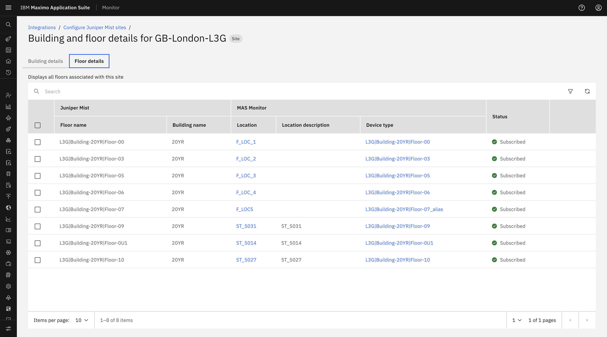
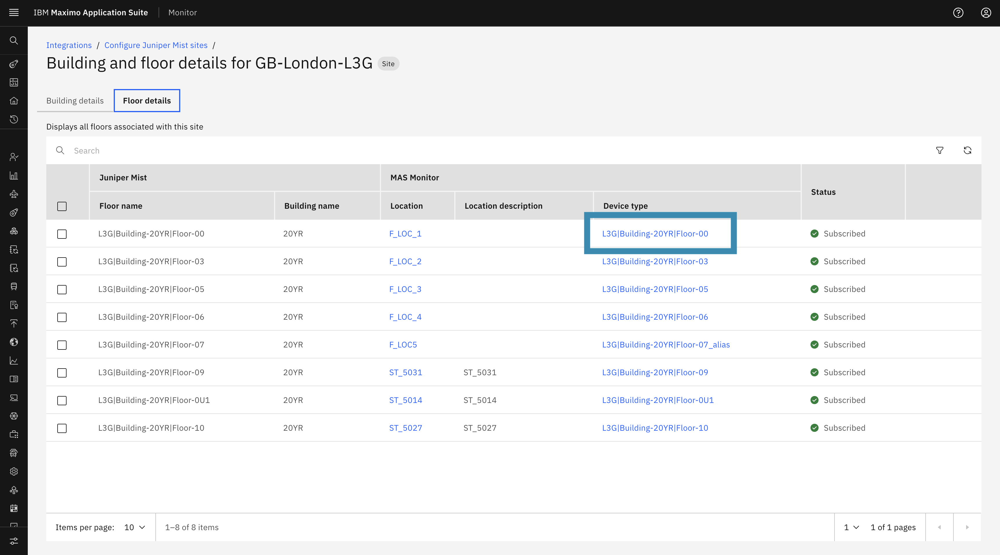
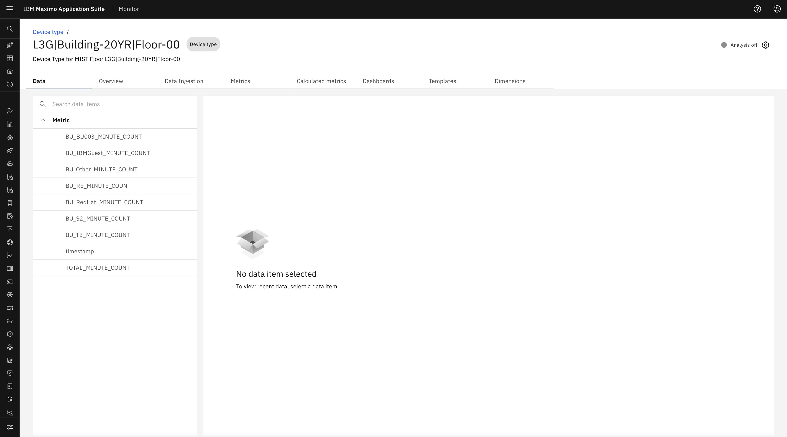
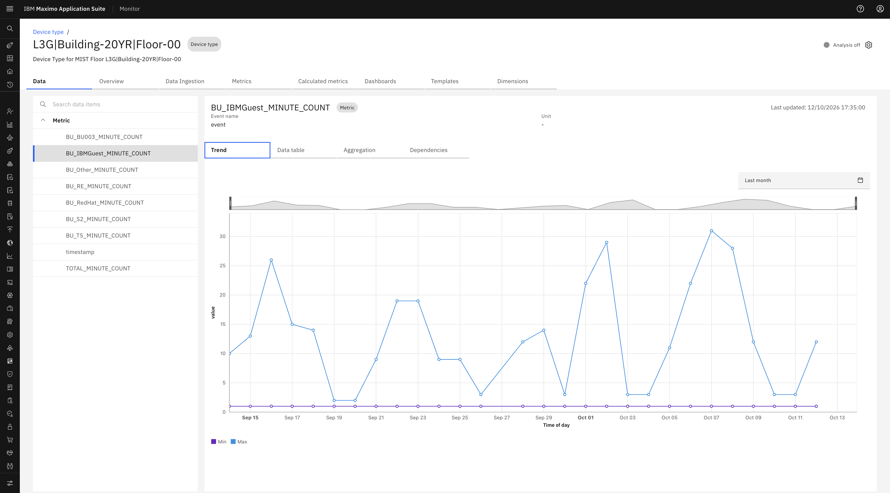
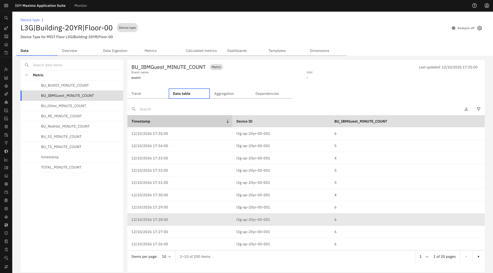

# Objectives

In this Exercise you will learn how DeviceTypes and Access Points are automatically created and assigned upon floor subscription.

---

*Before you begin:*  
This Exercise requires that you have:

1. Completed the pre-requisites required for [all labs](prereqs.md)
2. Completed the previous exercises
3. Subscribed at least one Juniper Mist Floor

---

## Device Type & Occupancy Metrics Creation

Once a Floor is subscribed, a background scheduler automatically prepares the selected location for MIST data collection:

- **DeviceType Creation**: Once a floor is successfully subscribed, the required **DeviceType** is created for the subscribed floor.
- **Access Point Discovery**: The **Access Points (APs)** are then discovered and created as Monitor devices under that device type. Access points are assigned to the subscribed floor location.
- **Business Unit Metrics**: Creates the required metrics for each Business Unit, including `total` and other business units.
- **WebSocket Connection**: The Site of the subscribed floor is connected to the WebSocket listener, allowing Monitor to receive live user events from Juniper Mist.

## Viewing Device Type Overview & Metrics

To view the generated DeviceType and its metrics:

1. Click the **Device Type link** from the Floor Details tab to open the **Device Type Overview** page.

    

2. In the **Data** tab, expand **Metrics** to view the available Business Unit metrics. 

    

3. Selecting a metric displays the corresponding data received for that metric.

    

    
