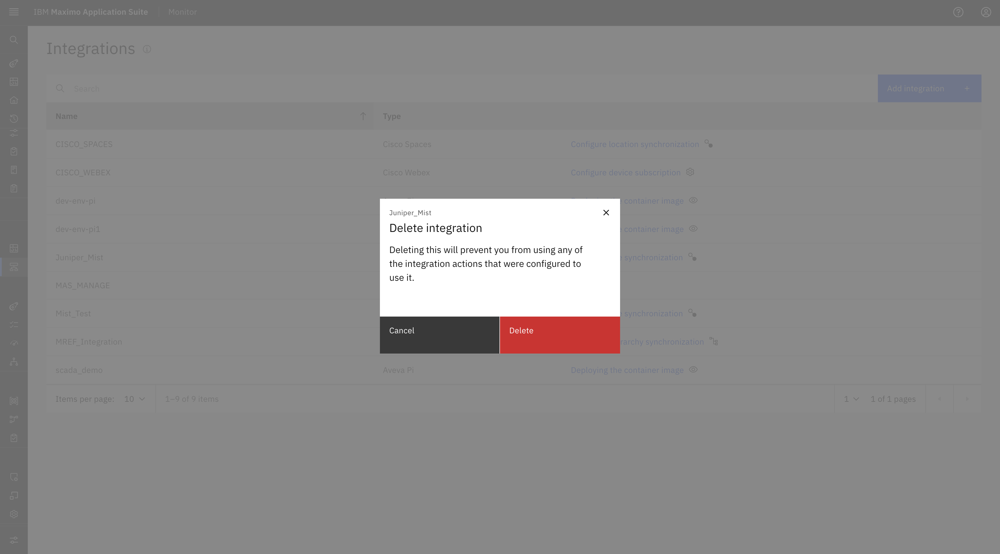

# Objectives

In this Exercise you will learn how to delete the Juniper Mist integration from IBM Maximo Monitor.

---

*Before you begin:*  
This Exercise requires that you have:

1. Completed the pre-requisites required for [all labs](prereqs.md)
2. Completed the previous exercises

---

## Delete Juniper Mist Integration

You can delete the Juniper Mist configuration if it is no longer required. However, this action has strict prerequisites.

!!! warning "Prerequisites before deleting"
    - Before deleting the Juniper MIST Configuration, ensure that **all Sites, Buildings, and Floors have been unassigned** from their Maximo Manage Locations.
    - Ensure that **all MIST Floors are unsubscribed**.

### Steps to Delete:

1. Navigate to **Setup → Integrations**.
2. Find the **Juniper Mist** configuration entry.
3. Click the **Action menu (⋮)** next to the integration.
4. Select **Delete**.

    

5. A confirmation popup will appear. Click **Delete** to confirm.

    

6. After confirmation, the configuration is deleted and the associated MIST Sites, Buildings, and Floors are removed from Monitor.
