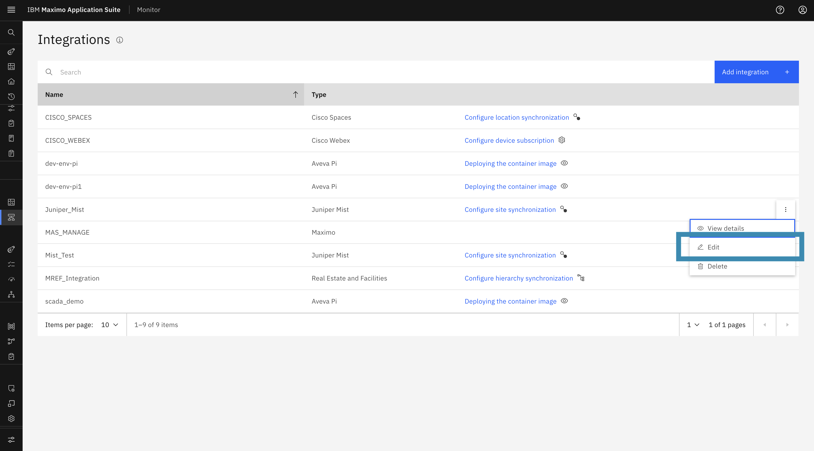
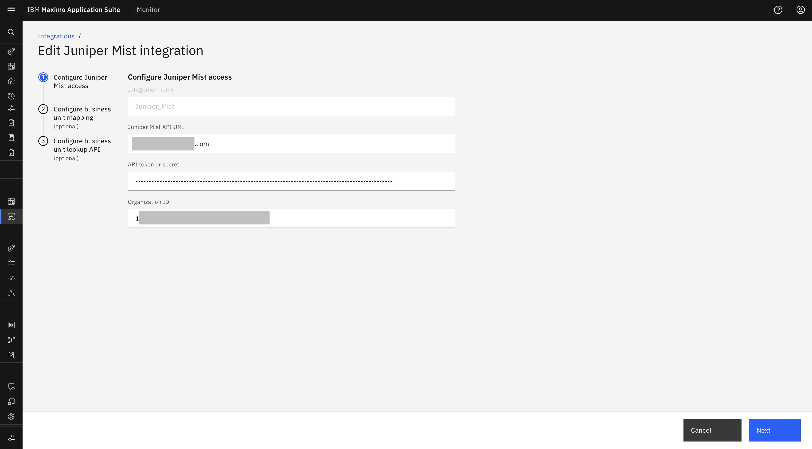
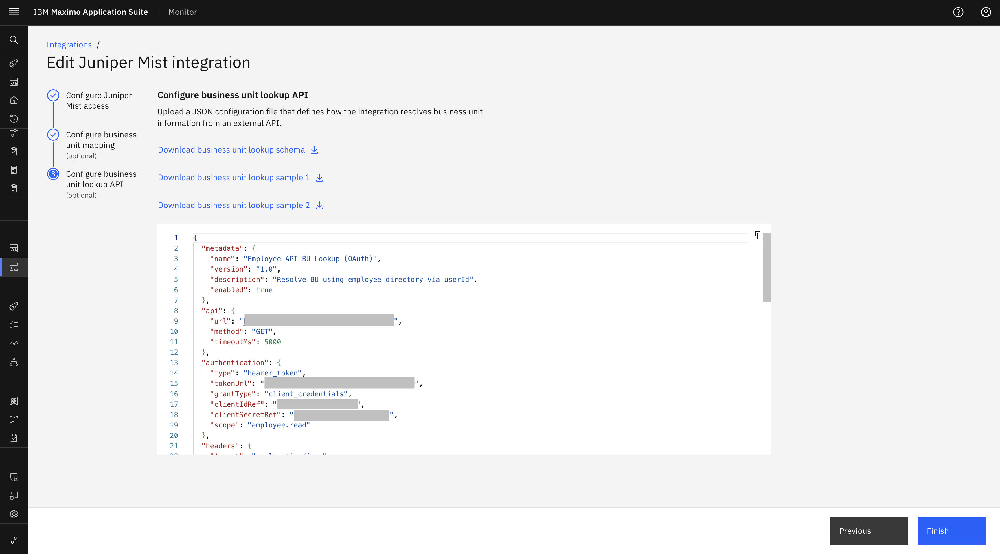

# Objectives

In this Exercise you will learn how to edit an existing Juniper Mist configuration in IBM Maximo Monitor.

---

*Before you begin:*  
This Exercise requires that you have:

1. Completed the pre-requisites required for [all labs](prereqs.md)
2. Completed the previous exercises

---

## Edit Juniper Mist Configuration

You can edit the Juniper Mist configuration from the **Edit** button provided with the configuration:

1. Navigate to **Setup → Integrations** in the MAS Monitor application.
2. Locate the **Juniper Mist** configuration from the integrations list.
3. Click on the **Action menu (⋮)** next to the integration name.
4. Select **Edit** from the action menu.

    

5. You will be redirected to the Edit Juniper Mist configuration wizard:
    - You can update the **API URL**, **API Token / secret**, and **Organization ID** from the Juniper Mist instance.

        

    - You can edit the **Business Unit mapping CSV file** and **Business Unit Lookup API**.

        

        

    - You will not be able to edit the **Integration Name**.
6. Click **Finish** to save changes.
