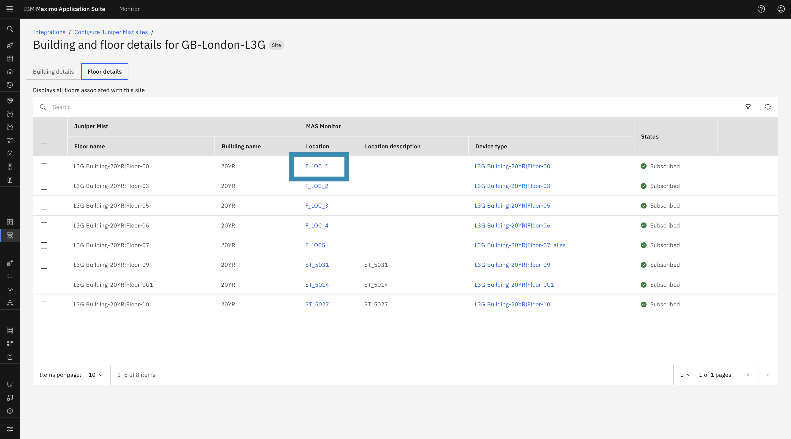
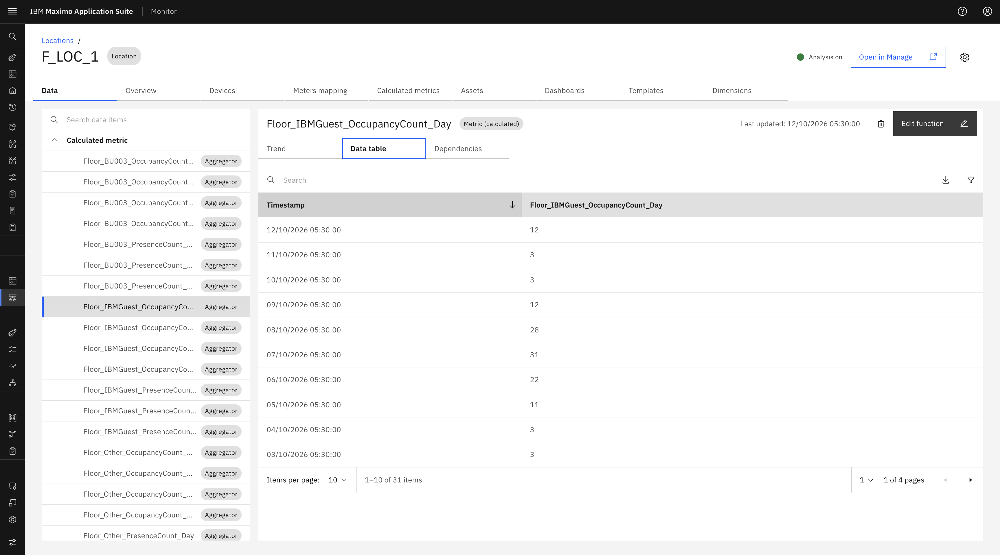
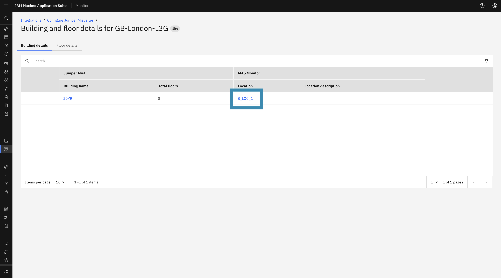
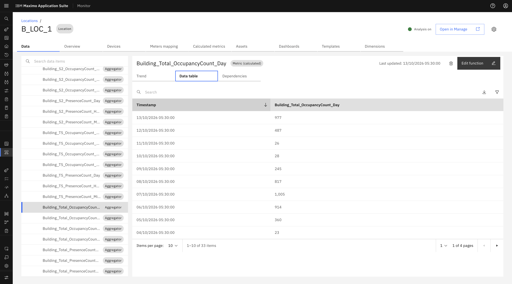
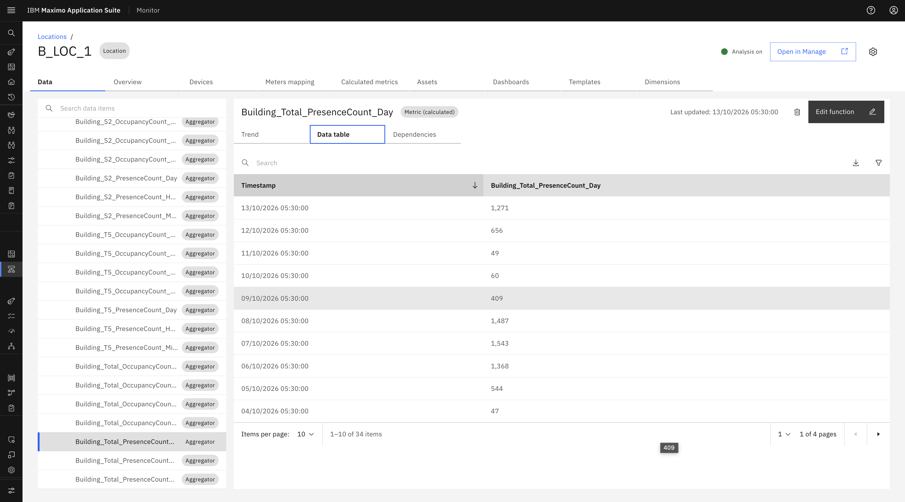
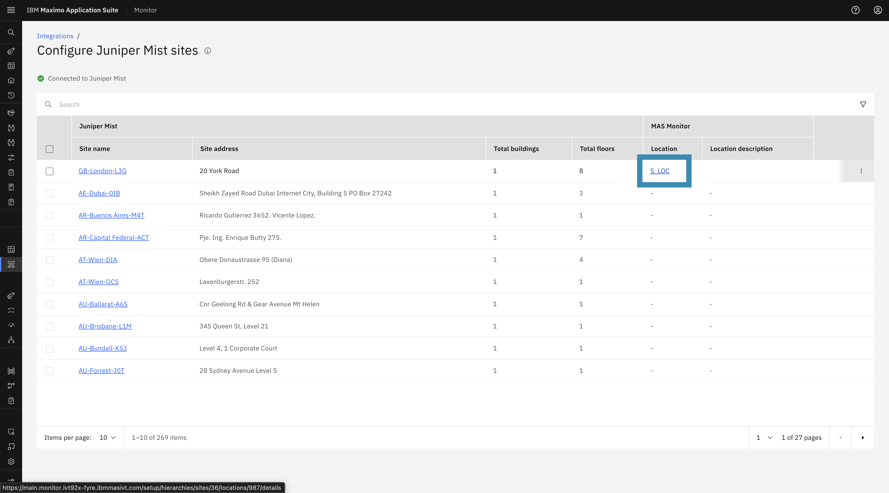
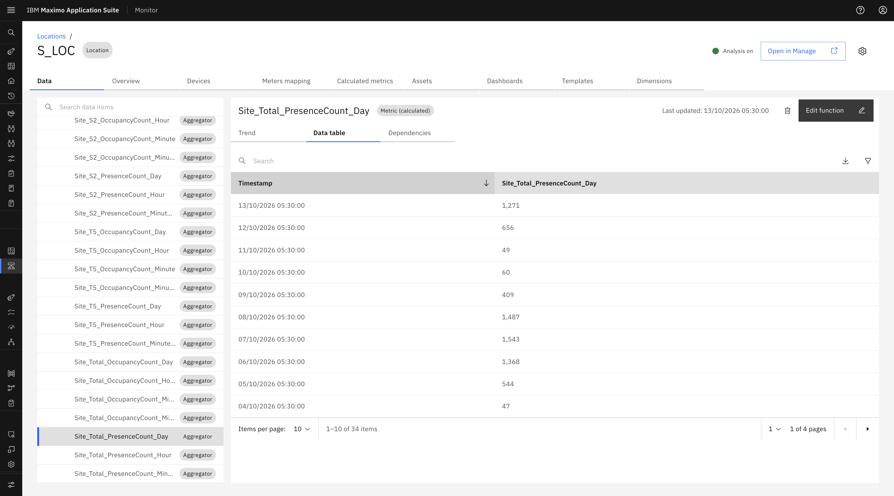

# Objectives

In this Exercise you will explore the automatically created Occupancy and Presence Count calculated metrics across Floor, Building, and Site locations.

---

*Before you begin:*  
This Exercise requires that you have:

1. Completed the pre-requisites required for [all labs](prereqs.md)
2. Completed the previous exercises
3. Subscribed at least one floor, building, or site

---

## Occupancy & Presence Count Calculated Metrics Creation

- Once metrics are created for each Business Unit, the system automatically creates the required **occupancy and presence calculated metrics** for the subscribed floor, building, and site.
- When the user updates the **BU Lookup CSV** in the Juniper MIST configuration, a background scheduler automatically applies the updated Business Unit mappings across all already-subscribed Sites, Buildings, and Floors.

---

## 1. Floor Location Calculated Metrics

To view the calculated metrics for a subscribed Floor:

1. Navigate to the **Floor Details** tab on the Site Details page.
2. Click the **Mapped location link** for the subscribed floor to open the **Location Details** page.

    

3. In the **Data** tab, view the calculated metrics.

Occupancy and presence count metrics generated at the floor level capture local utilization:

- `OCCUPANCY_COUNT` (Total & per Business Unit)
- `PRESENCE_COUNT` (Total & per Business Unit)

    

    

## 2. Building Location Calculated Metrics

To view the calculated metrics for a subscribed Building:

1. Navigate to the **Building Details** tab for the site.
2. Click the **Mapped location link** for the subscribed building to open the **Location Details** page.

    

3. In the **Data** tab, view the calculated metrics.

Calculated metrics are aggregated across all subscribed floors within the building:

- `BUILDING_OCCUPANCY_COUNT` (Total & per Business Unit)
- `BUILDING_PRESENCE_COUNT` (Total & per Business Unit)

    

    

## 3. Site Location Calculated Metrics

To view the calculated metrics for a subscribed Site:

1. Navigate to the **Mist Site List** page.
2. Click the **Mapped location link** for the subscribed site to open the **Location Details** page.

    

3. In the **Data** tab, view the calculated metrics.

Calculated metrics roll up across all buildings and floors within the site:

- `SITE_OCCUPANCY_COUNT` (Total & per Business Unit)
- `SITE_PRESENCE_COUNT` (Total & per Business Unit)

    

    
