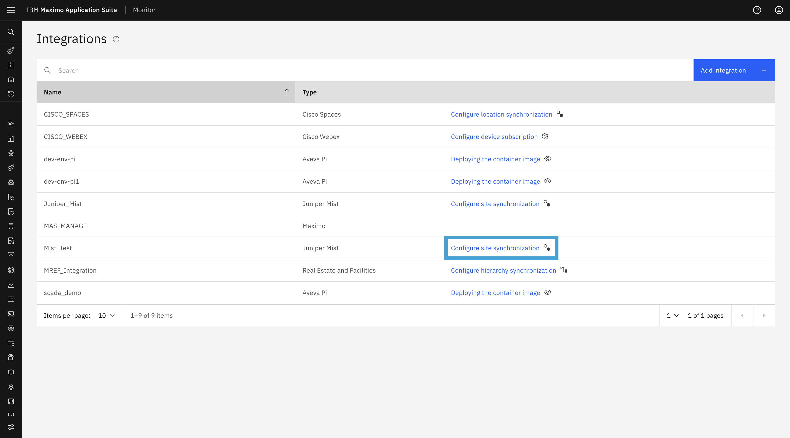
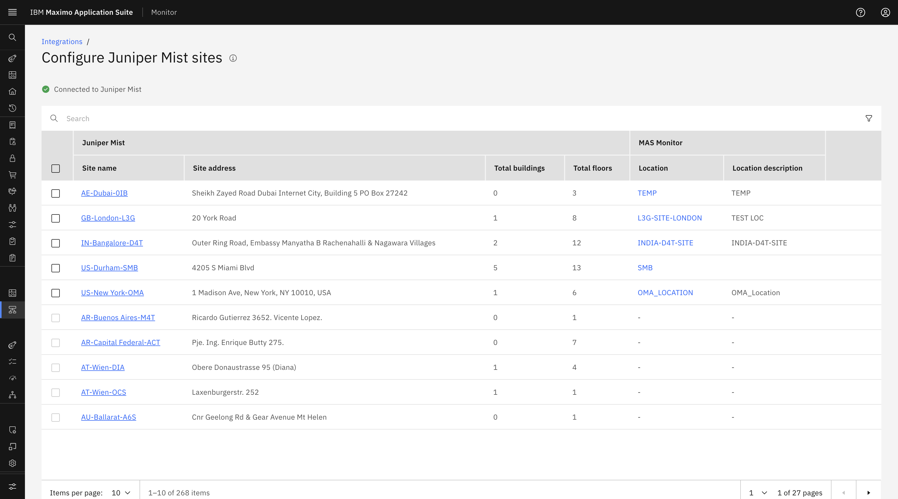
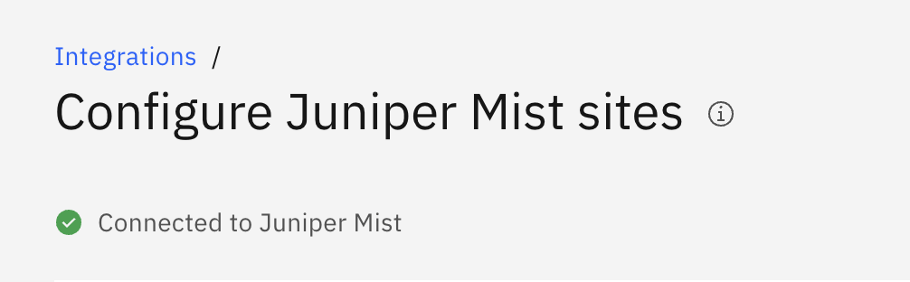
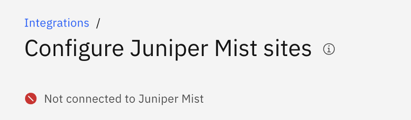
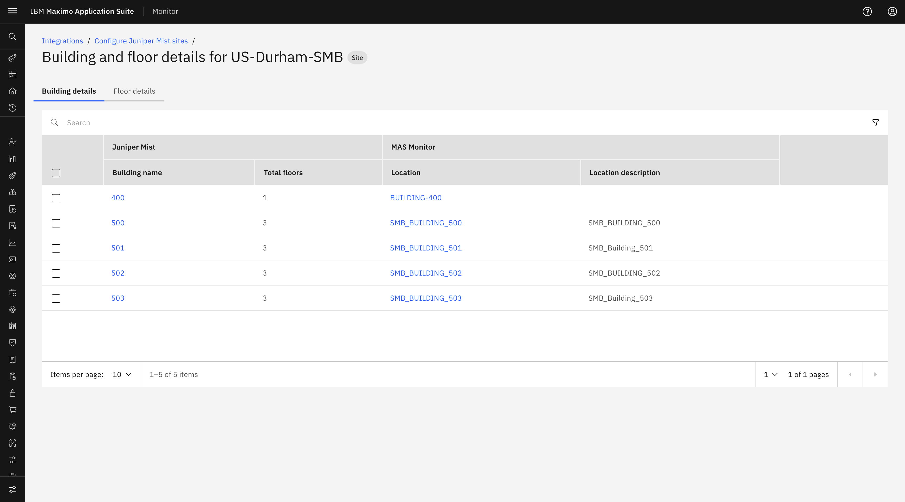
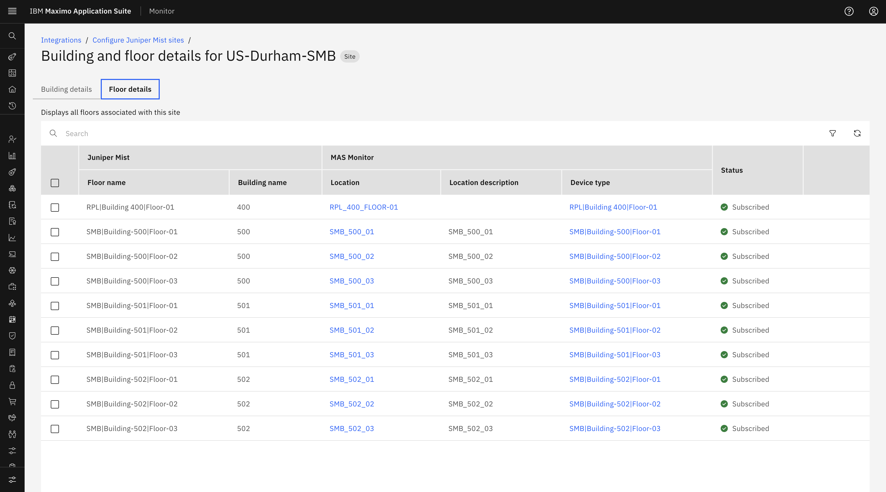

# Objectives

In this Exercise you will explore the synchronized Juniper Mist Sites, Buildings, and Floors, and understand the connection status indicators.

---

*Before you begin:*  
This Exercise requires that you have:

1. Completed the pre-requisites required for [all labs](prereqs.md)
2. Completed the previous exercises

---

## Configuration & Sync – Sites, Buildings & Floors

Once the Maximo–Juniper Mist configuration is successfully completed, IBM MAS Monitor establishes a connection with the configured Juniper Mist organization.

To access the site synchronization page:

1. Navigate to the **Integrations** list page in IBM MAS Monitor.
2. Locate your Juniper Mist integration entry in the list.
3. Click the **Configure site synchronization** link in the corresponding row.

- The system internally triggers a scheduler to fetch and synchronize Juniper Mist hierarchy (Site, Building, Floor) from the configured organization.
- The Mist hierarchy synchronization may take some time after the configuration is completed, so the Site/Building/Floor  may not appear immediately.

## Connection Status Indicators

At the top of the Juniper Mist Site Synchronization page, check the connection status:

- **Connected to Juniper Mist**: Indicates that a successful connection has been established with Juniper Mist and site data can be retrieved.

    { width=70% height=80%}

- **Not Connected to Juniper Mist**: Indicates that the Mist instance is currently unreachable or the connection could not be established.

    { width=70%}

## Navigating Synchronized Sites, Buildings, and Floors

The screen displays all Mist sites synchronized from the configured Mist organization, along with their buildings and floors.

### 1. Mist Site List
Displays all sites retrieved from Juniper Mist, including the Site Name, Mapped Location status, and Subscription Status.

### 2. Building Details
- Click the **Juniper Mist Site** link from the Mist Site List page.
- The system redirects to the **Building and Floor Details** page for the selected Mist Site.
- The screen displays all Mist Buildings in the **Building details** tab associated with the selected Mist Site, along with their current mapping status.

### 3. Floor Details
- The Floor Details page can be accessed from the **Floors** tab on the Site Details page, displaying all floors associated with the site and building.
- Alternatively, floor details can be accessed from the Building Details page by clicking the **Building Name** link in the Building Details 
table.
- The screen displays all Mist Floors, along with their current Mapped location and Subscribe Status.

