# Objectives

In this Exercise you will learn how to subscribe to Juniper Mist Floors, Buildings, and Sites to enable real-time data collection.

---

*Before you begin:*  
This Exercise requires that you have:

1. Completed the pre-requisites required for [all labs](prereqs.md)
2. Completed the previous exercises
3. Assigned Maximo Manage Locations to the target Juniper Mist Site, Building, and Floor

---

## Subscribe Juniper Mist Floor

To subscribe to a Juniper Mist Floor from the Floor Details page:

- The **Subscribe** action is available only after a Maximo Manage Location has been assigned to the Mist Floor.
- From the **Action menu (⋮)** for the required Mist Floor, select **Subscribe**.

    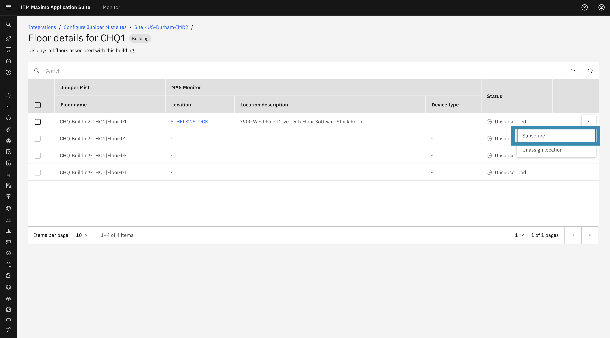

- A confirmation dialog will appear to confirm the subscription.
- Click **Subscribe** to proceed.

    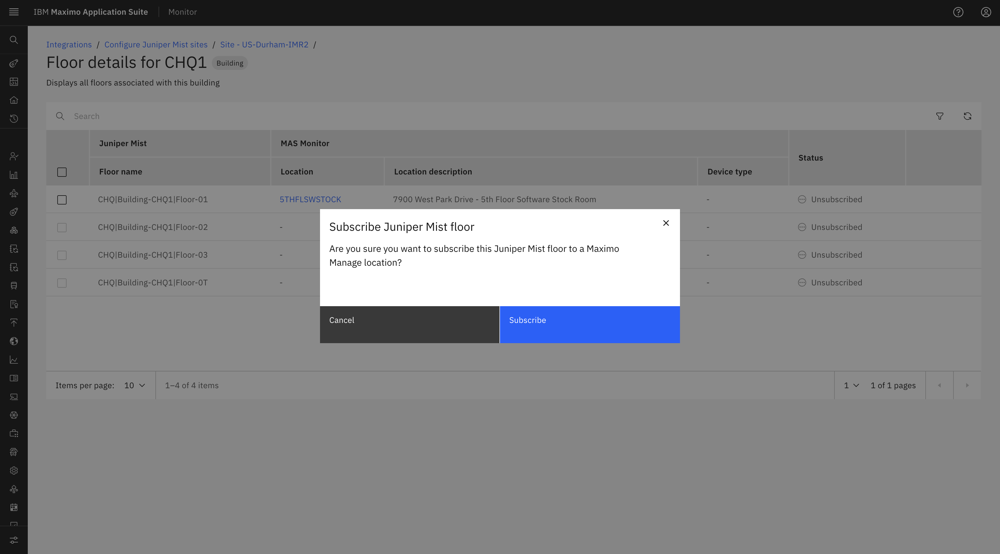

- Once the subscription is successful, the selected Mist Floor status will be updated to **Subscribed**.

    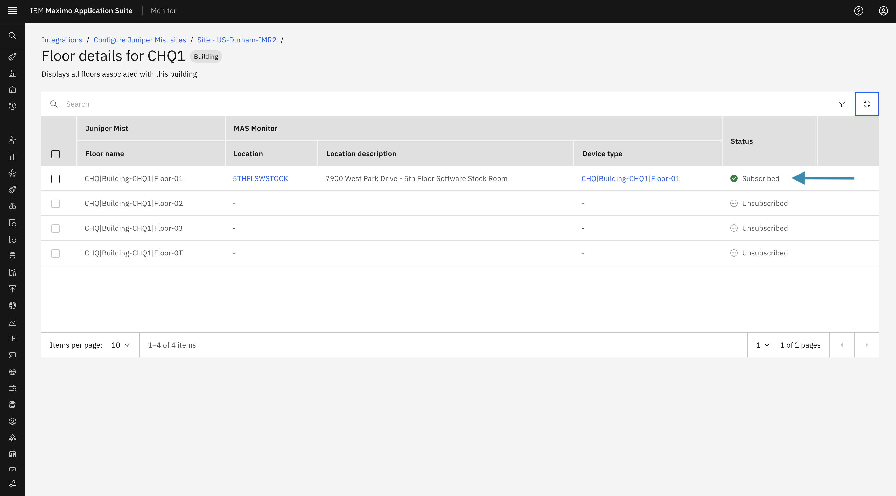

## Subscribe Juniper Mist Building

To subscribe to a Juniper Mist Building from the Building Details page:

- The **Subscribe** action is available only after a Maximo Manage Location has been assigned to the Mist Building.
- From the **Action menu (⋮)** for the required Mist Building, select **Subscribe**.

    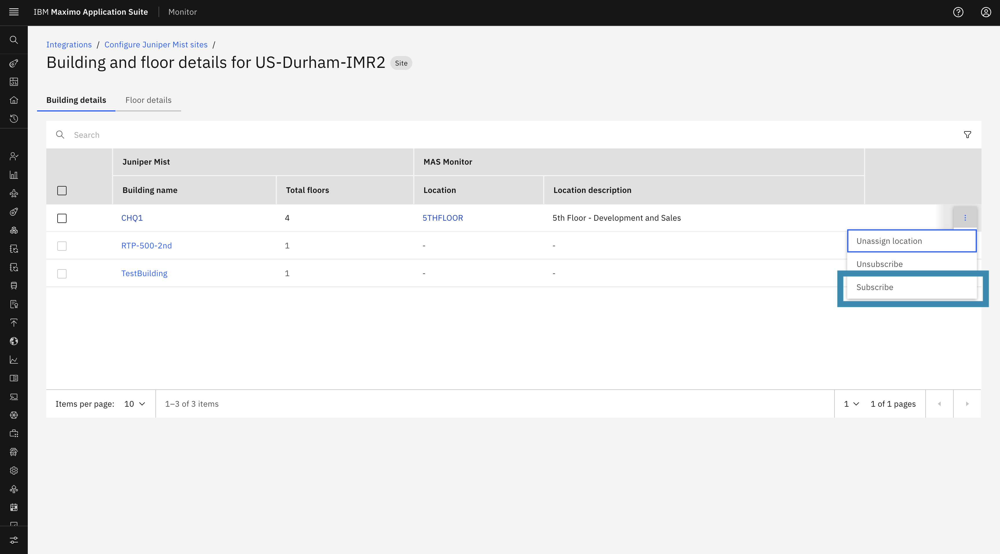

- A confirmation dialog will appear. Click **Subscribe** to proceed.

    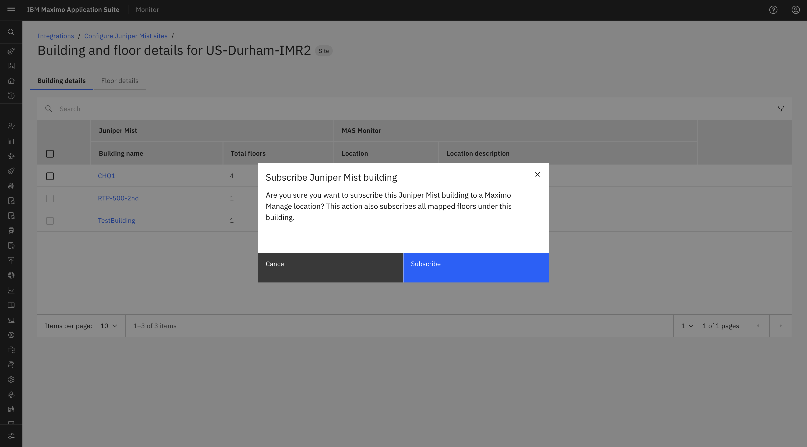

- Subscribing to a Mist Building initiates the subscription process for all floors associated with that building.
- During the subscription process, the system validates whether each floor has a Maximo Manage Location assigned:
    - Floors with an assigned location will be subscribed successfully.
    - Floors without an assigned location will not be subscribed and will generate an error.
    - If only some floors are successfully subscribed, the building will be marked as **Partially Subscribed**.
- In case of an error or partial subscription, the confirmation modal provides an option to **download the error file** for further review.

    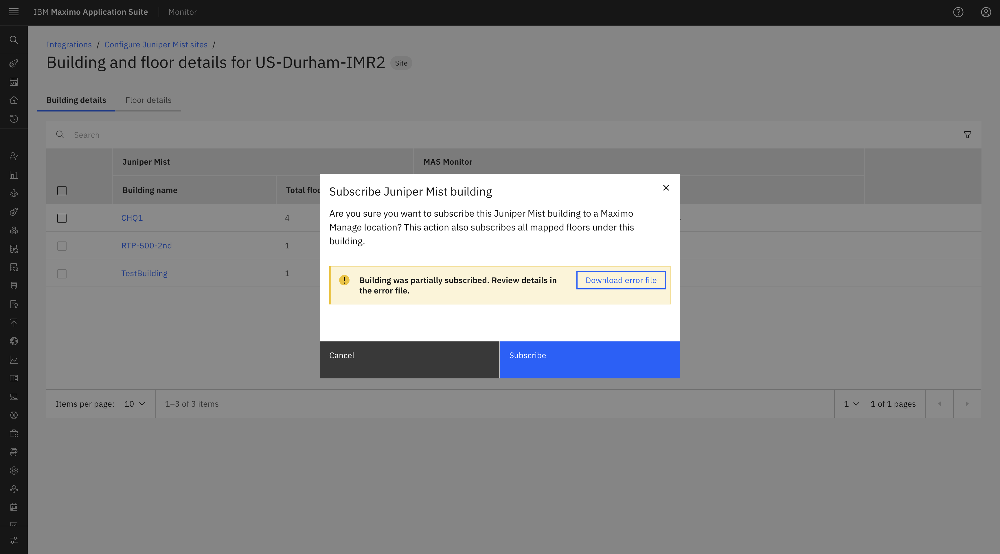

- Once the subscription is completed, the subscription status of the applicable Mist Building floors will be updated to **Subscribed**.

    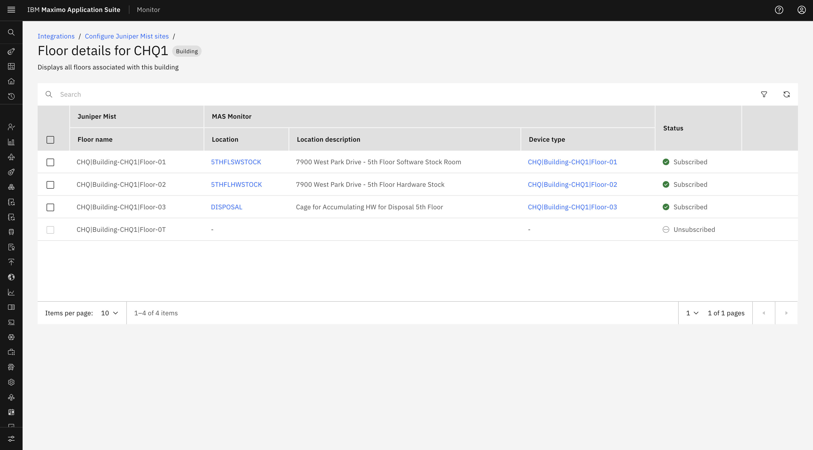

## Subscribe Juniper Mist Site

To subscribe to a Juniper Mist Site from the Site List page:

- The **Subscribe** action is available only after a Maximo Manage Location has been assigned to the Mist Site.
- From the **Action menu (⋮)** for the required Mist Site, select **Subscribe**.

    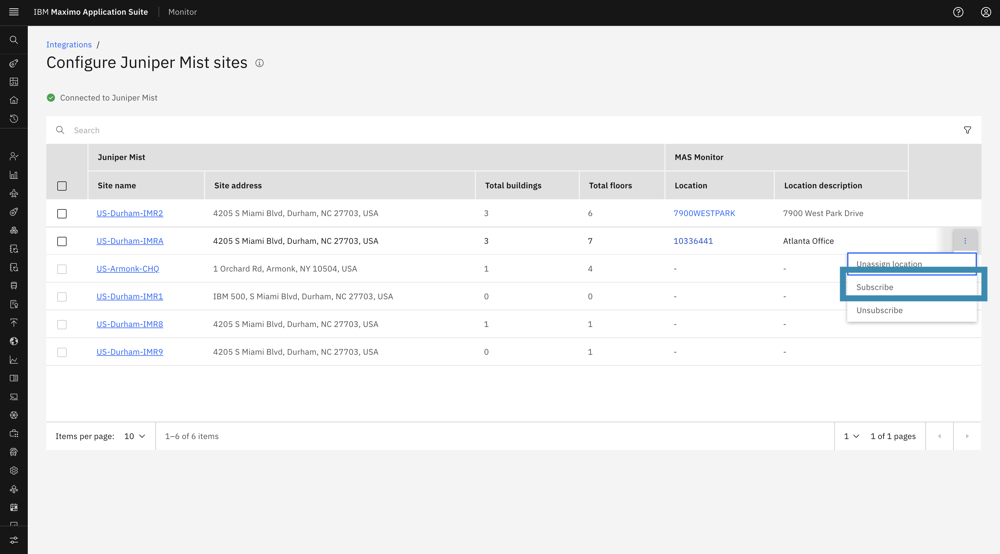

- A confirmation dialog will appear. Click **Subscribe** to proceed.

    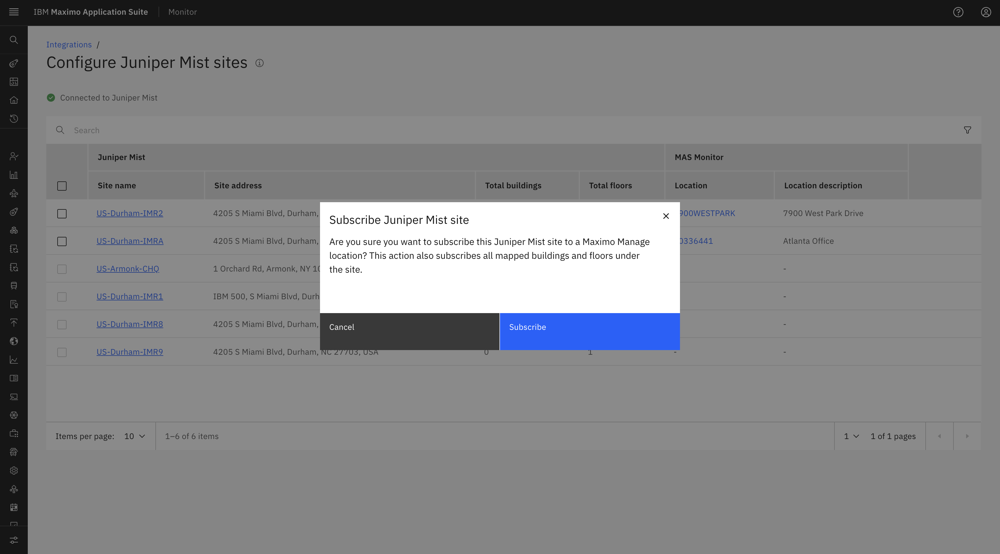

- Subscribing to a Mist Site initiates the subscription process for all Buildings and associated Floors within that Site.
- During the subscription process, the system validates whether a Maximo Manage Location is assigned to each Building and Floor:
    - Floors with an assigned location will be subscribed successfully.
    - Floors without an assigned location will not be subscribed and will generate an error.
    - If only some Floors are successfully subscribed, the Site will be marked as **Partially Subscribed**.
- In case of an error or partial subscription, the confirmation modal provides an option to **download the error file** for further review.

    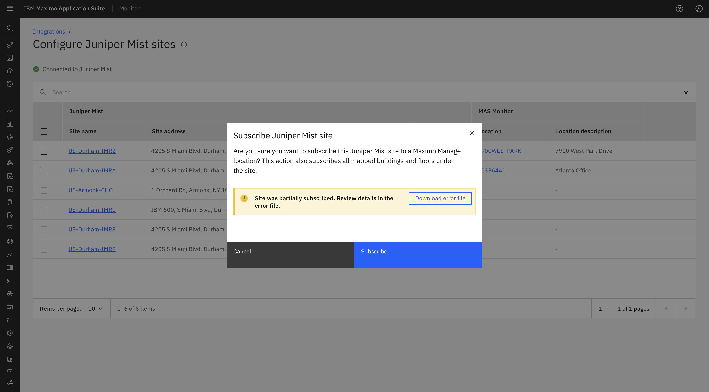

- Once the subscription is completed successfully, the applicable Mist Site associated floors subscription statuses will be updated to **Subscribed**.

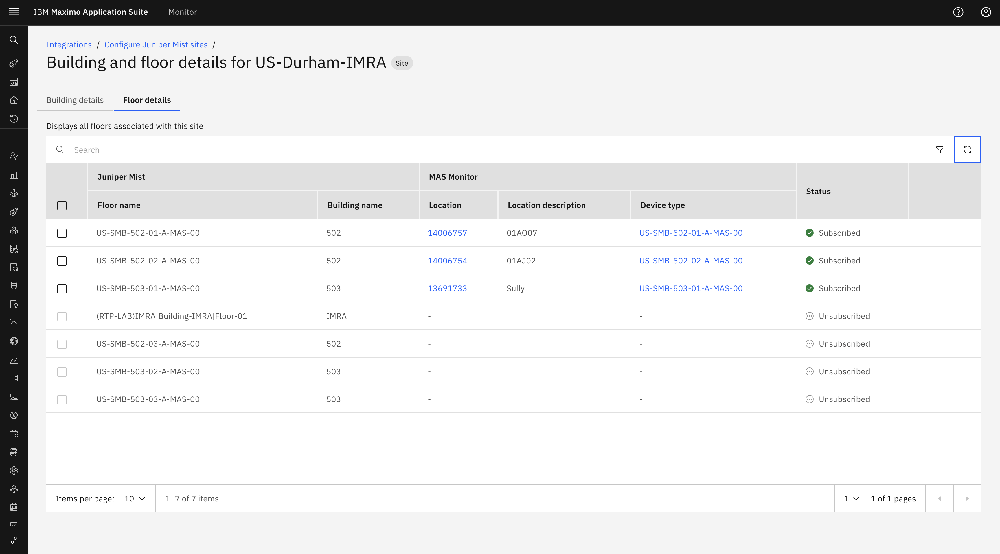
