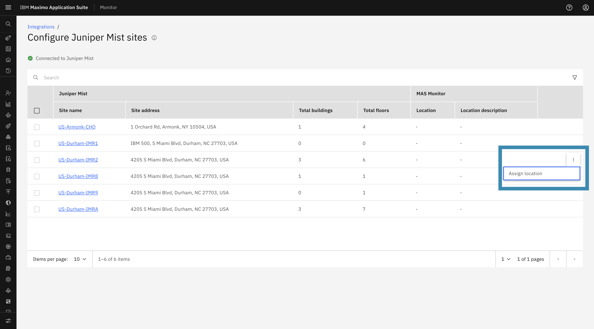
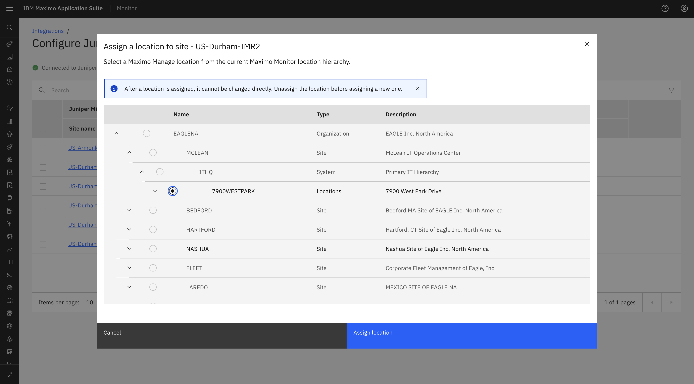
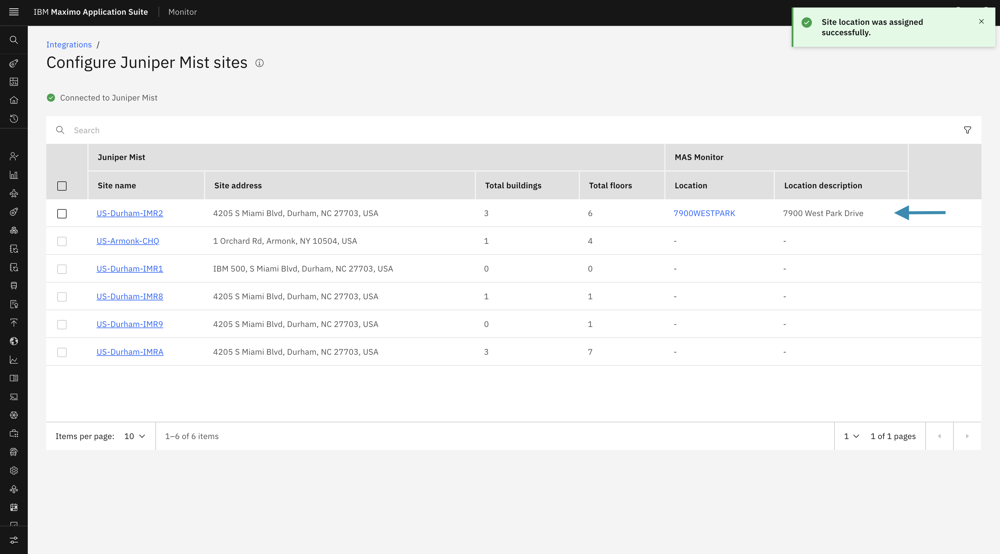
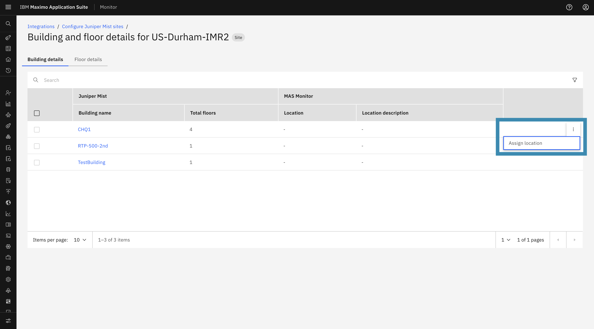
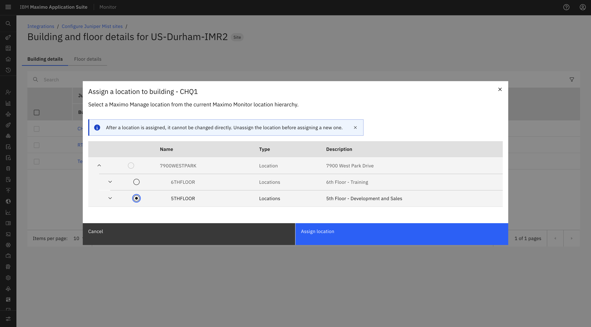
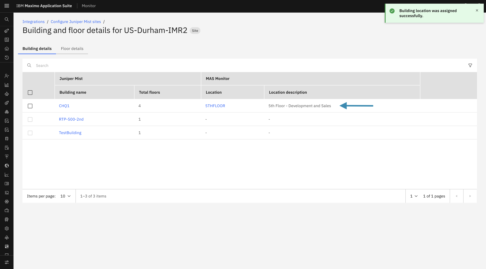
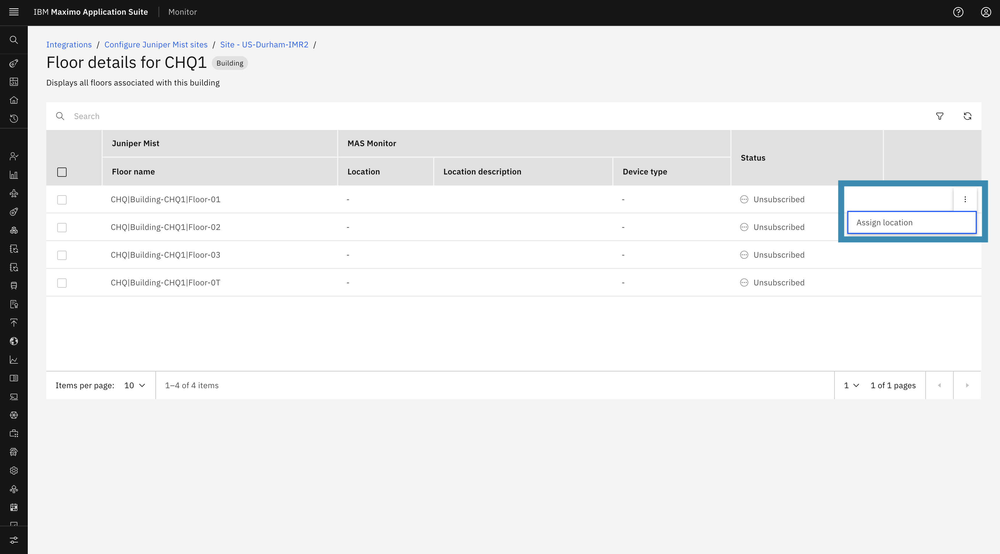
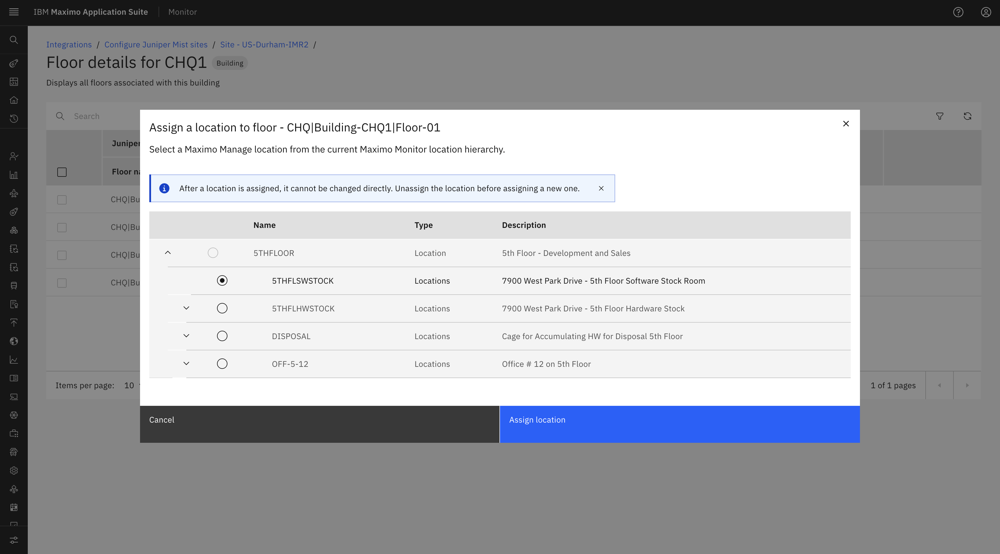
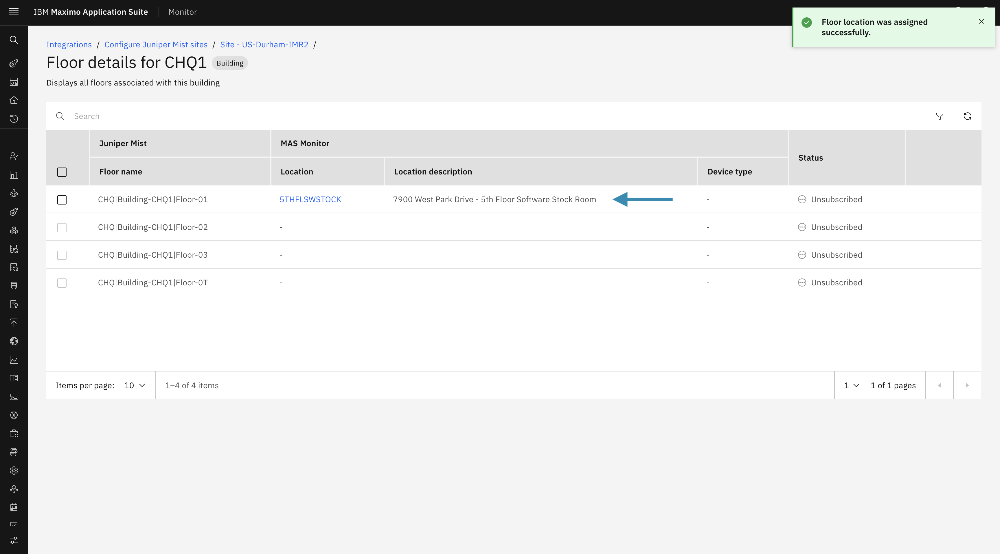

# Objectives

In this Exercise you will learn how to assign Maximo Manage Locations to synchronized Juniper Mist Sites, Buildings, and Floors.

---

*Before you begin:*  
This Exercise requires that you have:

1. Completed the pre-requisites required for [all labs](prereqs.md)
2. Completed the previous exercises
3. Verified that Juniper Mist sites, buildings, and floors are synchronized

---

## Assign Maximo Manage Location to a Mist Site

To assign a Maximo Manage Location to a Mist Site from the Site List page:

1. From the **Action menu (⋮)** for the required Mist Site, select **Assign Location**.

    

2. A modal window will open displaying the Maximo Manage hierarchy.
3. Expand the hierarchy in the following order:
   **Organization** → **Site** → **System** → **Location**
4. Select the required **Manage Location** from the hierarchy.
5. Click **Assign Location** to complete the mapping.

    

6. The selected Maximo Manage Location will be successfully assigned to the corresponding Mist Site.

    

<!-- --- -->

## Assign Maximo Manage Location to a Mist Building

To assign a Maximo Manage Location to a Mist Building from the Building details page:

1. Navigate to the **Building Details** page for the site.
2. From the **Action menu (⋮)** for the required Mist Building, select **Assign Location**.

    

3. A modal window will open displaying the Maximo Manage Location hierarchy.
4. It will show the child locations of the selected site manage location in the hierarchy. Expand the hierarchy.
5. Select the required **Manage Location** from the hierarchy.
6. Click **Assign Location** to complete the mapping.

    

7. The selected Maximo Manage Location will be successfully assigned to the corresponding Mist Building.

    

<!-- --- -->

## Assign Maximo Manage Location to a Mist Floor

To assign a Maximo Manage Location to a Mist Floor from the Floor details page:

1. Navigate to the **Floor Details** page.
2. From the **Action menu (⋮)** for the required Mist Floor, select **Assign Location**.

    

3. A modal window will open displaying the Maximo Manage Location hierarchy.
4. It will show child locations of the selected site or building manage location in the hierarchy. Expand the hierarchy.
5. Select the required **Manage Location** from the hierarchy.
6. Click **Assign Location** to complete the mapping.

    

7. The selected Maximo Manage Location will be successfully assigned to the corresponding Mist Floor.

       

<!-- --- -->
