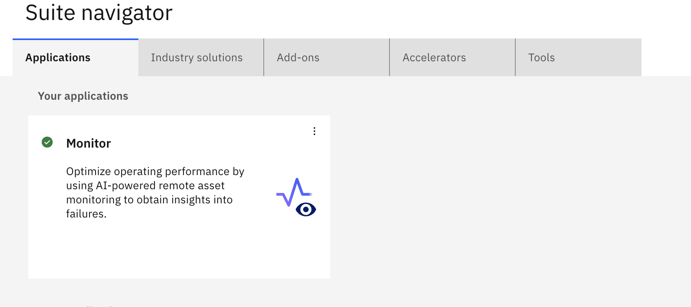
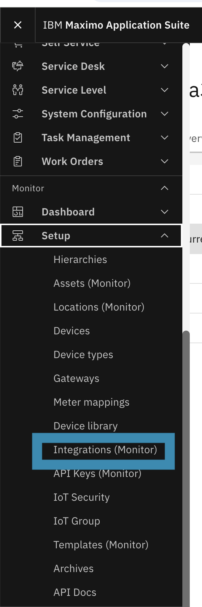
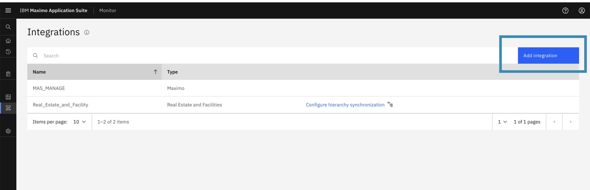
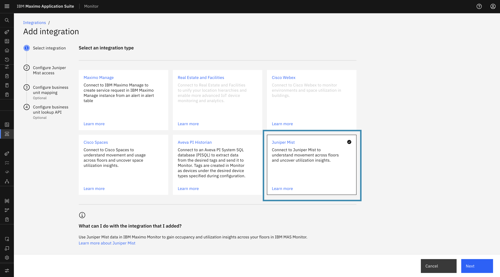
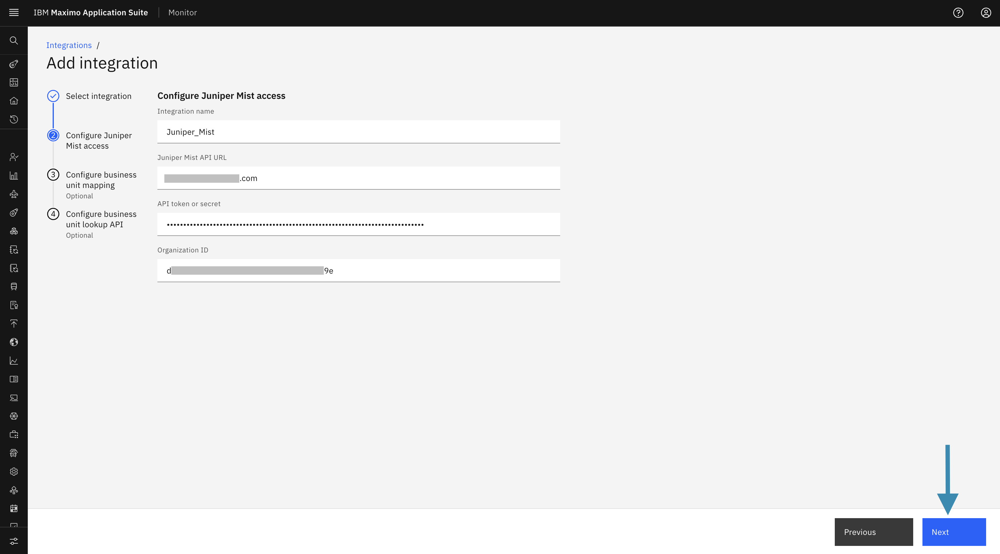
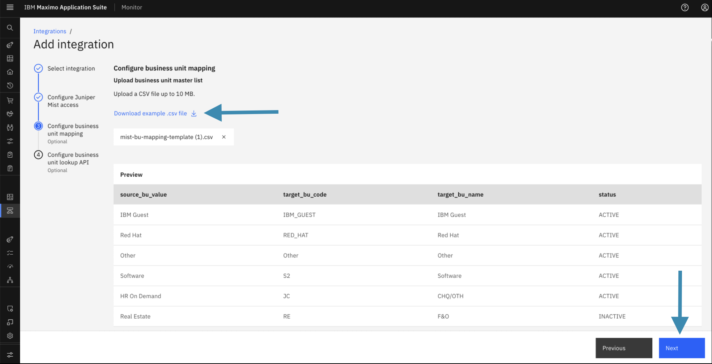
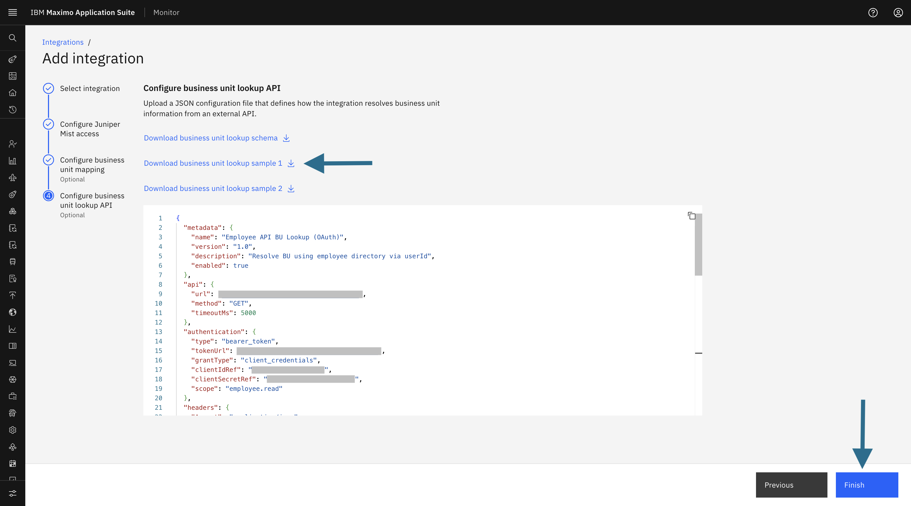
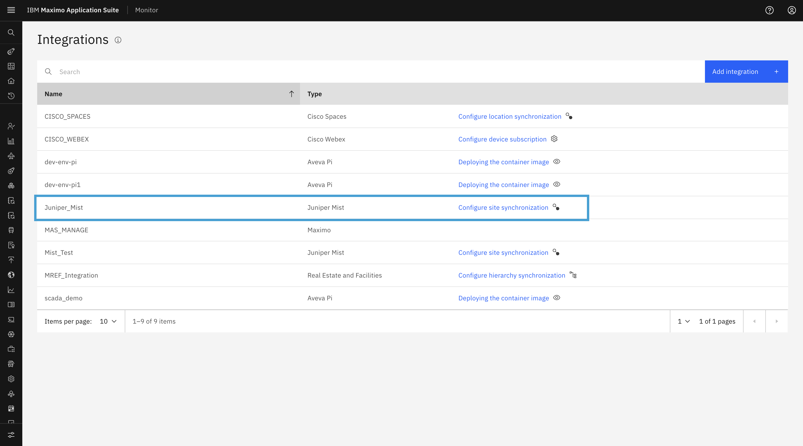

# Objectives

In this Exercise you will learn how to configure the Juniper Mist integration in IBM MAS Monitor, upload Business Unit mapping configurations, and set up the dynamic Business Unit Lookup API.

<!-- ---

*Before you begin:*  
This Exercise requires that you have:

1. Completed the pre-requisites required for [all labs](prereqs.md)
2. Completed the previous exercises

--- -->

## Steps to Configure the Integration

1. **Log in to IBM MAS Monitor**  
   Access your MAS Monitor environment by logging in with your credentials in Maximo Application Suite.

    { width=70% height=50% }

2. **Navigate to Integrations**  
   Open the left-side navigation menu. Scroll to the **Monitor applications list** and select **Setup → Integrations** from the menu options.

    { width=20% height=10% }

3. **Add a New Integration**  
   On the Integrations screen, click the **Add Integration** button to start configuring a new integration.

    

4. **Select Juniper Mist as the Integration Type**  
   From the **Integration Type** list, select **Juniper Mist** and click **Next**.

    

<!-- --- -->

## Step 1: Configure Juniper Mist Access

In this step, provide the required Juniper Mist connection details:

- **Integration Name**: Specify a unique name for the integration.
- **API URL**: Enter your Juniper Mist cloud URL (for example, `https://api.mist.com`).
- **API Token / Secret**: Enter the API access token obtained from your Juniper Mist organization.
- **Organization ID**: Enter the organization UUID from your Juniper Mist account.

Click **Next** to proceed.  

These details are used to establish connectivity between Juniper Mist and IBM MAS Monitor.  

<!-- --- -->

## Step 2: Configure Business Unit (Optional)

The **Configure Business Unit** step is used to upload the Business Unit (BU) mapping configuration file.

- A **sample configuration file** is available for download and reference.
- The uploaded file is used to resolve users to their respective Business Units.
- After uploading the file, the system displays the Business Units parsed from the configuration, allowing administrators to:
    - Review the Business Unit mappings
    - Validate the uploaded configuration  

Click **Next** to proceed.

This is an **optional step**, and users can skip it if not needed.

<!-- --- -->

## Step 3: Configure Business Unit Lookup API (Optional)

The **Configure Business Unit Lookup API** step allows administrators to configure the API details required to resolve user identities to Business Units dynamically at runtime:

- **BU Lookup API Endpoint**: Enter the endpoint URL for user identity resolution.
- **Authentication Details**: Provide required authentication credentials (API key, bearer token, etc.).

These settings enable IBM MAS Monitor to dynamically determine the appropriate Business Unit for users during runtime.  

Click **Finish** to complete the integration configuration.

This is an **optional step**, and users can skip it.

<!-- --- -->

## Verify Integration

Once the integration is added successfully, its details will appear on the **Integrations list** page.

Congratulations, you have successfully configured the Juniper Mist Integration in Maximo Monitor.

<!-- --- -->
