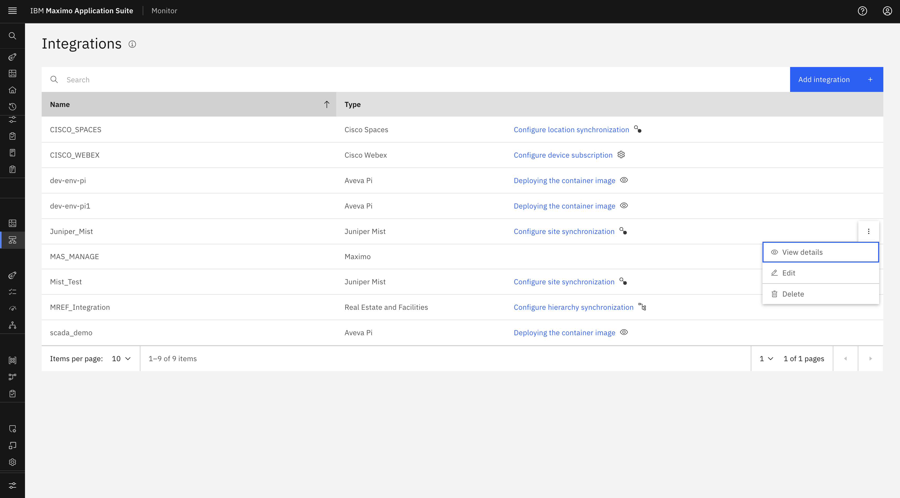
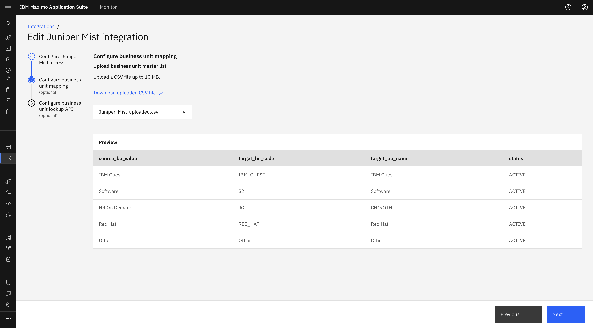
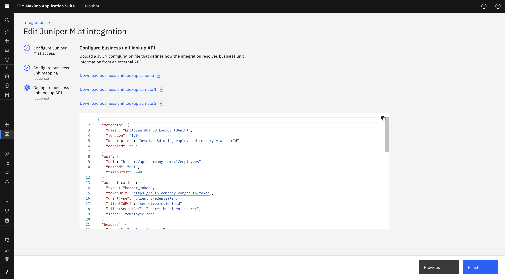
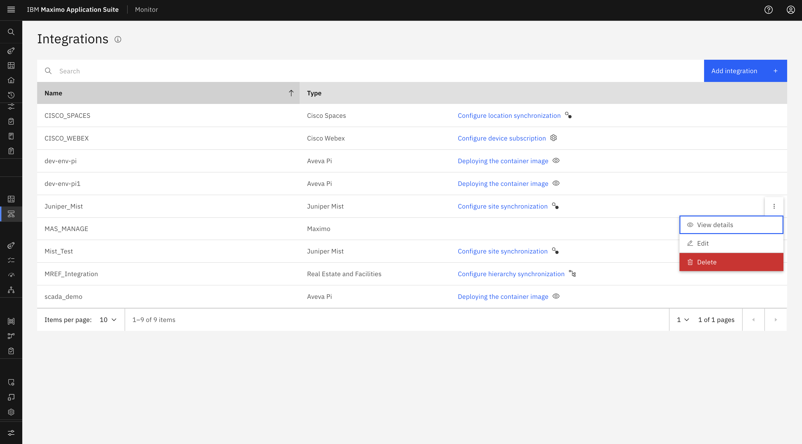

# Objectives

In this Exercise you will learn how to edit an existing Juniper Mist configuration or delete the integration from IBM Maximo Monitor.

---

*Before you begin:*  
This Exercise requires that you have:

1. Completed the pre-requisites required for [all labs](prereqs.md)
2. Completed the previous exercises

---

## Edit Juniper Mist Configuration

You can edit the Juniper Mist configuration from the **Edit** button provided with the configuration:

1. Navigate to **Setup → Integrations** in the MAS Monitor application.
2. Locate the **Juniper Mist** configuration from the integrations list.
3. Click on the **Action menu (⋮)** next to the integration name.
4. Select **Edit** from the action menu.

    

5. You will be redirected to the Edit Juniper Mist configuration wizard:
    - You can update the **API URL**, **API Token / secret**, and **Organization ID** from the Juniper Mist instance.

        

    - You can edit the **Business Unit mapping CSV file** and **Business Unit Lookup API**.

        

        

    - You will not be able to edit the **Integration Name**.
6. Click **Finish** to save changes.

<!-- --- -->

## Delete Juniper Mist Integration

You can delete the Juniper Mist configuration if it is no longer required. However, this action has strict prerequisites.

### Prerequisites Before Deleting:

- Before deleting the Juniper MIST Configuration, ensure that **all Sites, Buildings, and Floors have been unassigned** from their Maximo Manage Locations.
- Ensure that **all MIST Floors are unsubscribed**.

### Steps to Delete:

1. Navigate to **Setup → Integrations**.
2. Find the **Juniper Mist** configuration entry.
3. Click the **Action menu (⋮)** next to the integration.
4. Select **Delete**.

    

5. A confirmation popup will appear. Click **Delete** to confirm.

    

6. After confirmation, the configuration is deleted and the associated MIST Sites, Buildings, and Floors are removed from Monitor.

<!-- --- -->
