# Objectives

In this Exercise you will learn how to Unsubscribe from Juniper Mist locations to stop data collection, and how to Unassign Maximo Manage locations.

---

*Before you begin:*  
This Exercise requires that you have:

1. Completed the pre-requisites required for [all labs](prereqs.md)
2. Completed the previous exercises

---

## Unsubscribing from Juniper Mist Locations

### Unsubscribing from a Juniper MIST Floor

To stop data collection for a floor, unsubscribe from it first:

- The **Unsubscribe** option is available only when the MIST Floor is subscribed.
- From the **Action menu (⋮)** for the required MIST Floor, select **Unsubscribe**.

    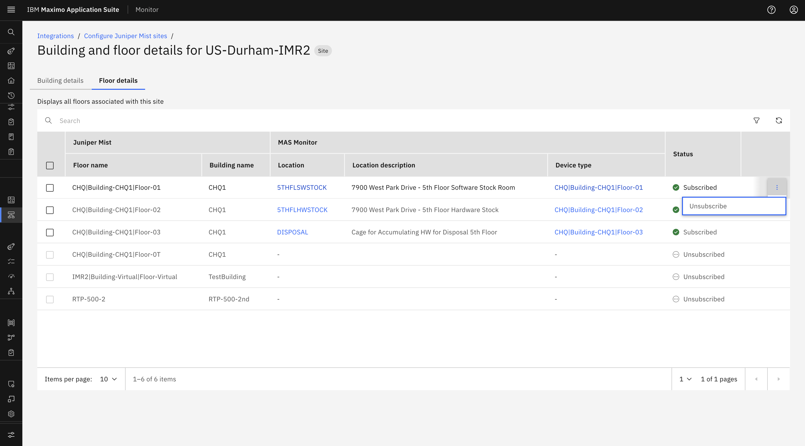

- A confirmation dialog appears. Click **Unsubscribe** to confirm.

    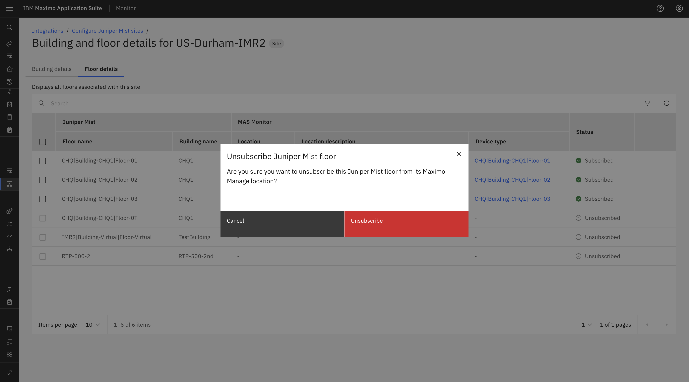

- Unsubscribing stops the flow of data from Juniper MIST to Maximo Monitor.
- Once unsubscribe is completed successfully, the subscription status of the MIST Floor is updated to `Unsubscribed`.

    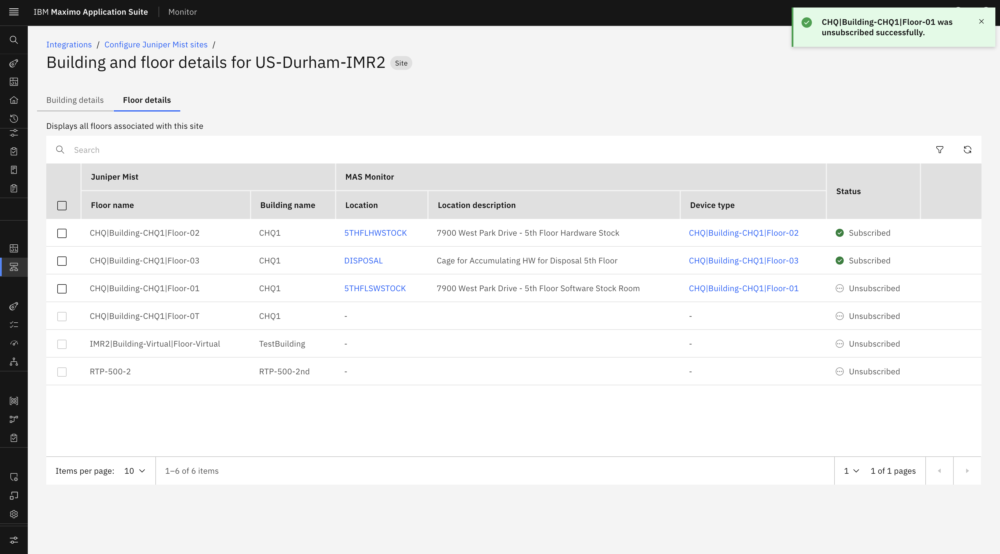

<!-- --- -->

### Unsubscribing from a Juniper MIST Building

- The **Unsubscribe** option is available only when a Maximo Manage Location is assigned to the MIST Building.
- From the **Action menu (⋮)** for the required MIST Building, select **Unsubscribe**.

    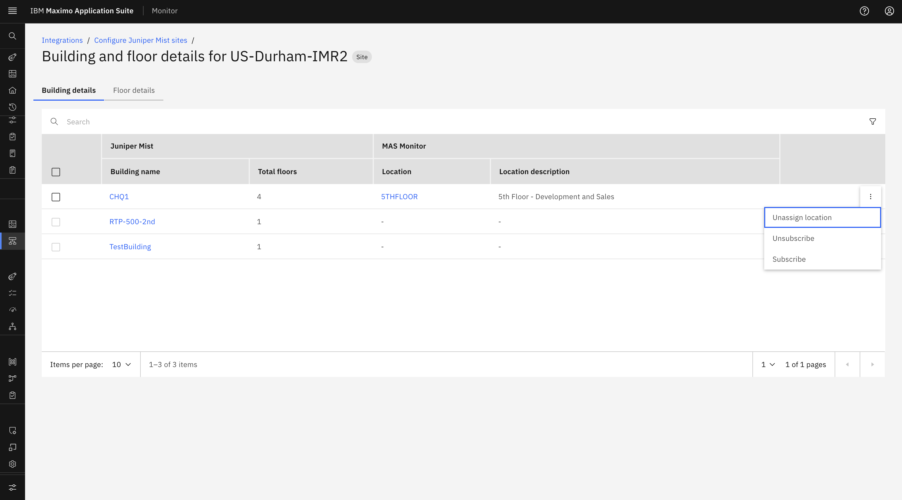

- A confirmation dialog appears. Click **Unsubscribe** to confirm.

    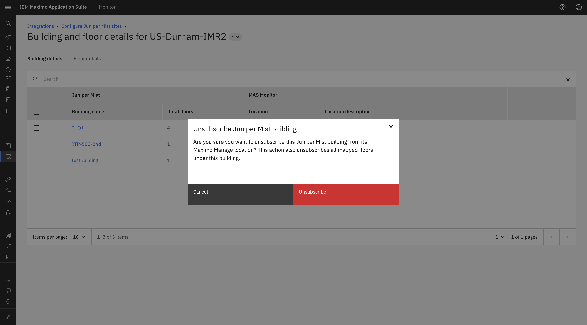

- Unsubscribing stops the flow of data from the Juniper Building to Maximo Monitor.
- During the unsubscribe process, the system checks whether a Maximo Manage Location is assigned to each Floor:
    - Floors with an assigned location are unsubscribed successfully.
    - Floors without an assigned location are not unsubscribed and are reported as errors.
- If only some Buildings or Floors are unsubscribed successfully, the Building is marked as `Partially Unsubscribed`.
- If an error or partial unsubscribe occurs, the confirmation dialog provides an option to **download the error file** for review.

    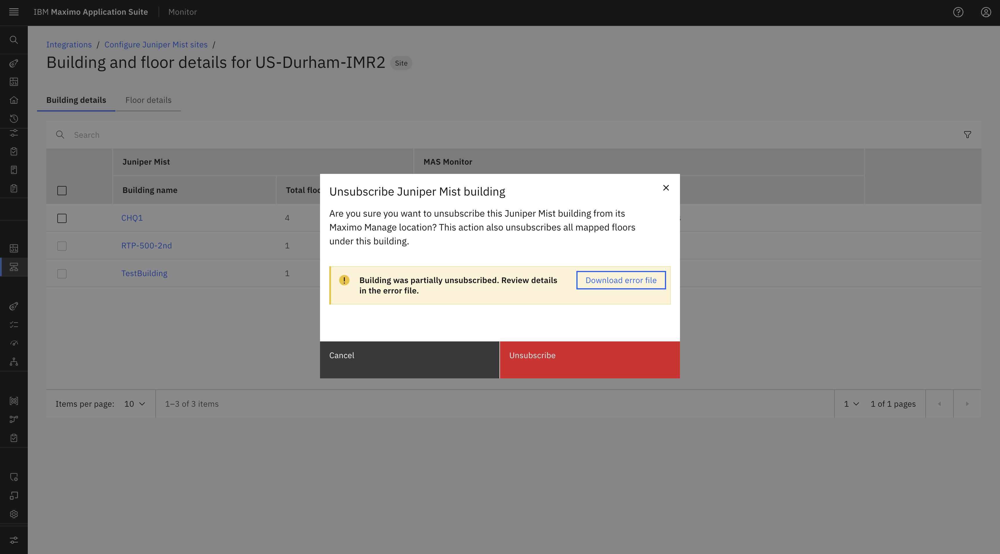

    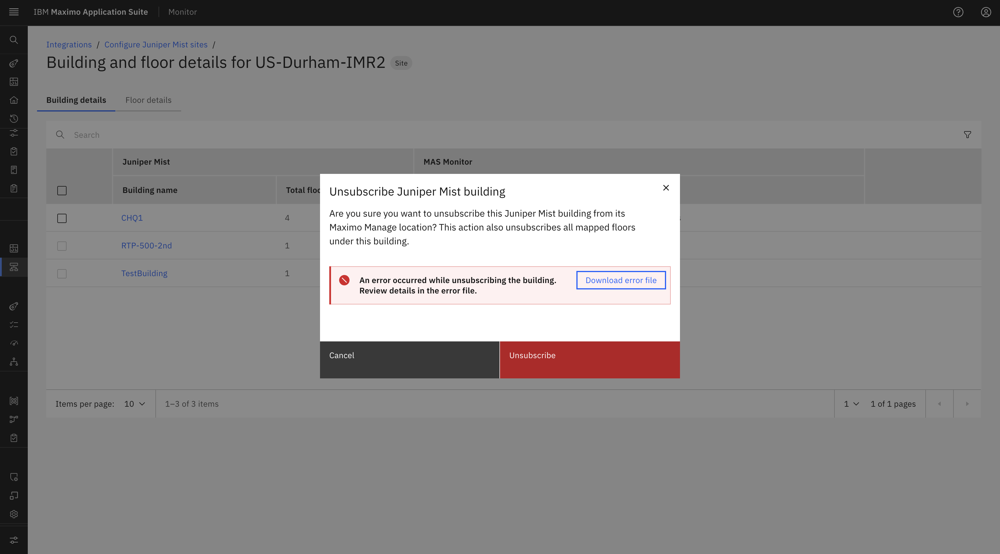

- Once unsubscribe is completed successfully, the subscription status of the applicable MIST Floors is updated to `Unsubscribed`.

    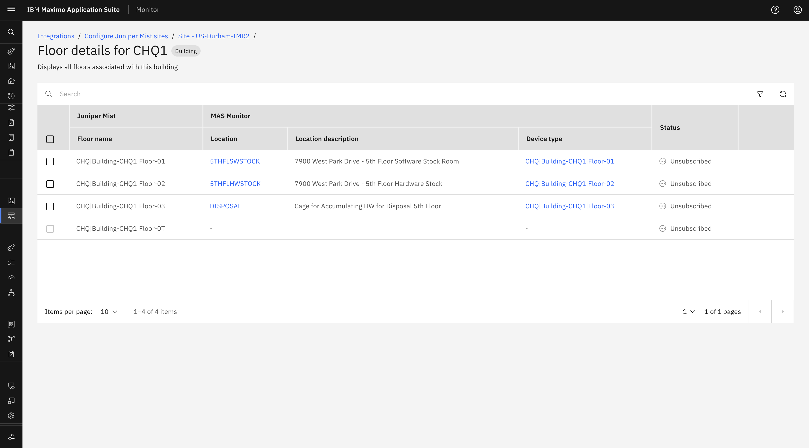

<!-- --- -->

### Unsubscribing from a Juniper MIST Site

- To stop data collection for a site, unsubscribe from it first.
- The **Unsubscribe** option is available only when a Maximo Manage Location is assigned to the MIST Site.
- From the **Action menu (⋮)** for the required MIST Site, select **Unsubscribe**.

    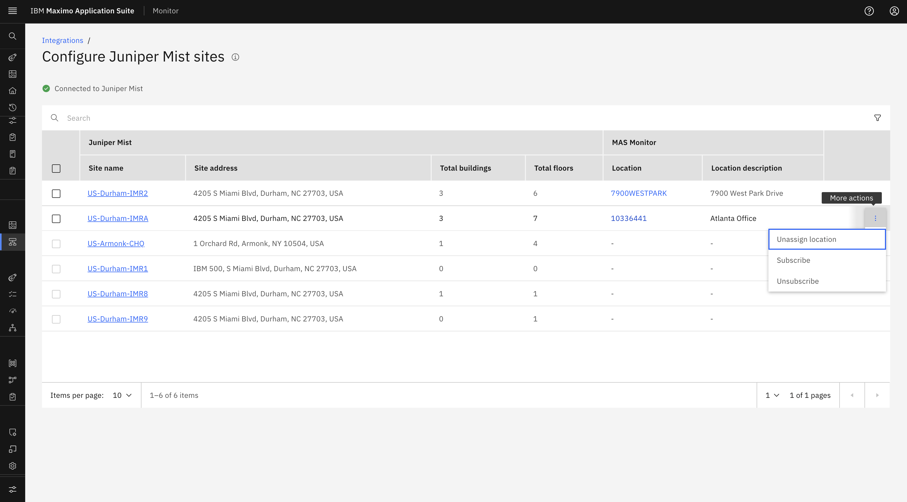

- A confirmation dialog appears. Click **Unsubscribe** to confirm.

    

- Unsubscribing stops the flow of data from Juniper MIST to Maximo Monitor.
- During the unsubscribe process, the system checks whether a Maximo Manage Location is assigned to each Building and Floor:
    - Buildings and Floors with an assigned location are unsubscribed successfully.
    - Buildings and Floors without an assigned location are not unsubscribed and are reported as errors.
- If only some Buildings or Floors are unsubscribed successfully, the Site is marked as `Partially Unsubscribed`.
- If an error or partial unsubscribe occurs, the confirmation dialog provides an option to **download the error file** for review.

    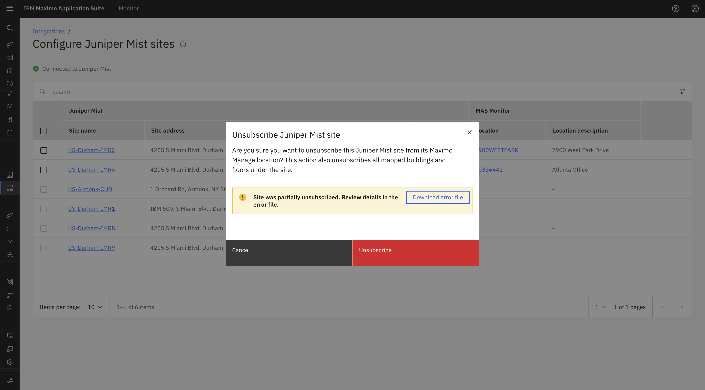

    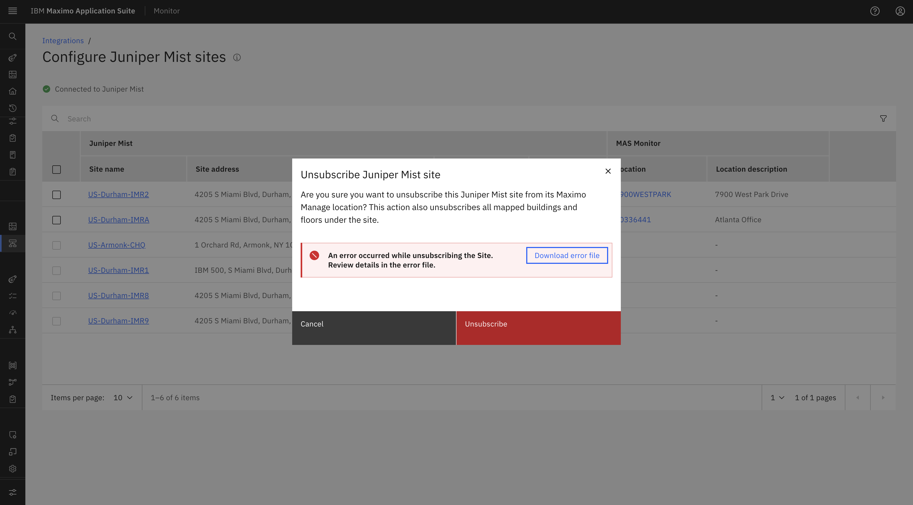   

- Once unsubscribe is completed successfully, the subscription status of the applicable MIST Floors is updated to `Unsubscribed`.

    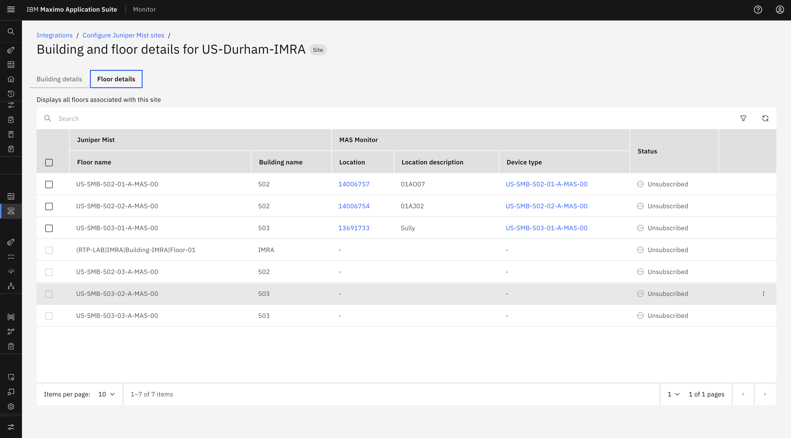

<!-- --- -->

## Unassigning Maximo Manage Locations

### Unassign a Maximo Manage Location from a MIST Floor

1. From the **Action menu (⋮)** for the required MIST Floor, select **Unassign Location**.

    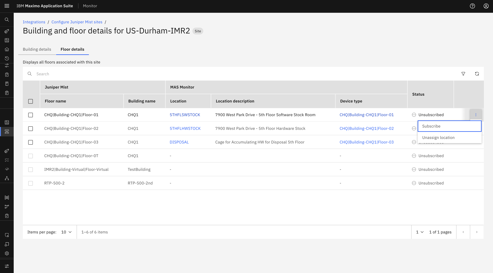

2. A confirmation dialog appears to confirm the removal of the Maximo Manage Location from the Floor.
3. The dialog also provides an option to **delete the calculated metrics** associated with the location.
4. Click **Unassign Location** to complete the action.

    

5. The selected Maximo Manage Location is successfully unassigned from the corresponding MIST Floor.

    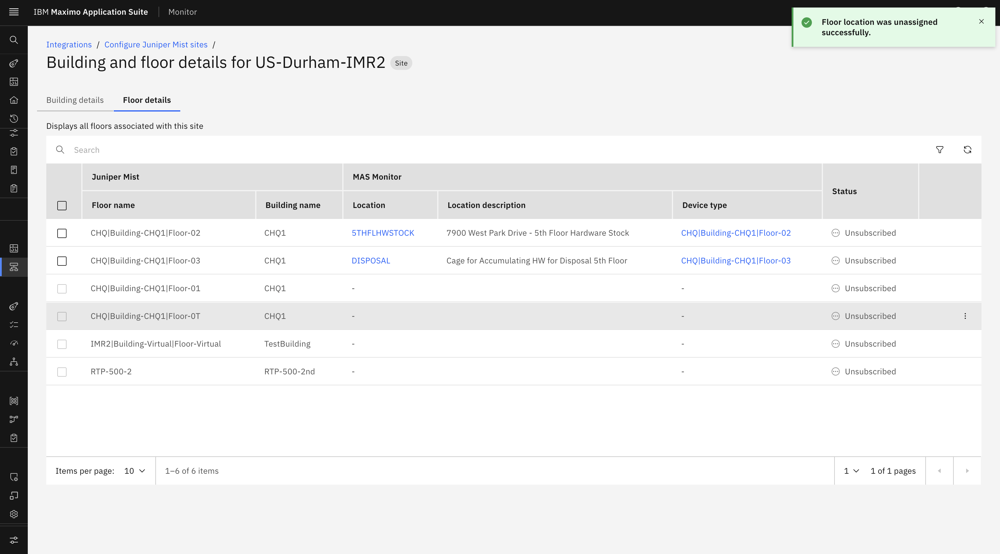

<!-- --- -->

### Unassign a Maximo Manage Location from a MIST Building

1. From the **Action menu (⋮)** for the required MIST Building, select **Unassign Location**.

    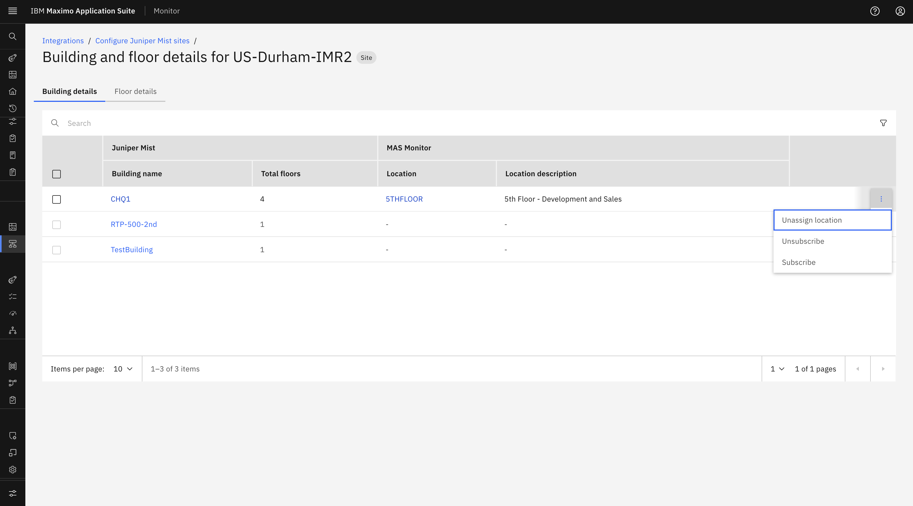

2. A confirmation dialog appears to confirm the removal of the Maximo Manage Location from the Building.
3. The dialog also provides an option to **delete the calculated metrics** associated with the location.
4. Click **Unassign Location** to complete the action.

    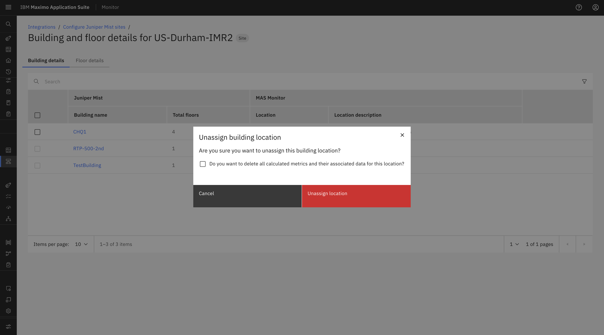

5. The selected Maximo Manage Location is successfully unassigned from the corresponding MIST Building.

    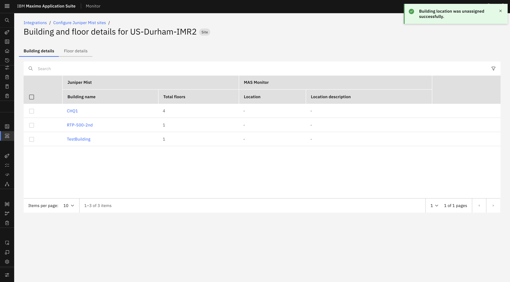

!!! warning "Dependency Rule"
    If any associated **Floor** still has a Maximo Manage Location assigned, the system will not allow the Building-level location to be unassigned and will display an error.
    
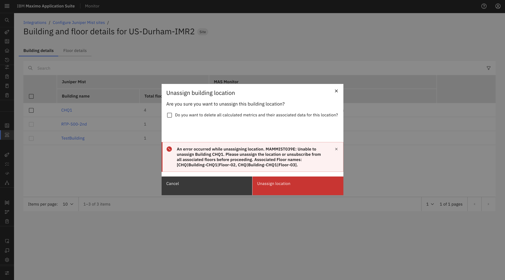

<!-- --- -->

### Unassign a Maximo Manage Location from a MIST Site

1. From the **Action menu (⋮)** for the required MIST Site, select **Unassign Location**.

    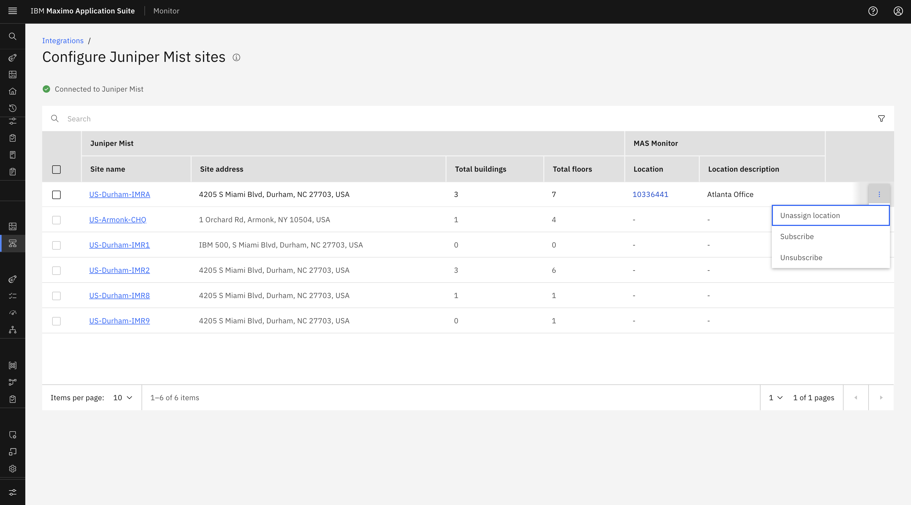

2. A confirmation dialog appears to confirm the removal of the Maximo Manage Location from the Site.
3. The dialog also provides an option to **delete the calculated metrics** associated with the location.
4. Click **Unassign Location** to complete the action.

    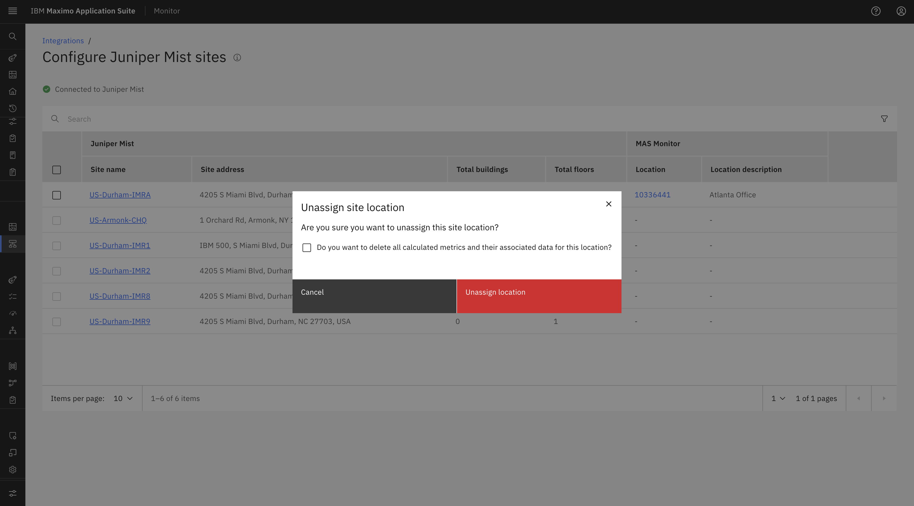

5. The selected Maximo Manage Location is successfully unassigned from the corresponding MIST Site.

    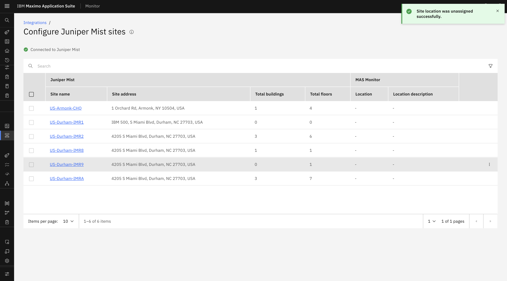

!!! warning "Dependency Rule"
    If any associated **Building or Floor** still has a Maximo Manage Location assigned, the system will not allow the Site-level location to be unassigned and will display an error.

<!-- --- -->
